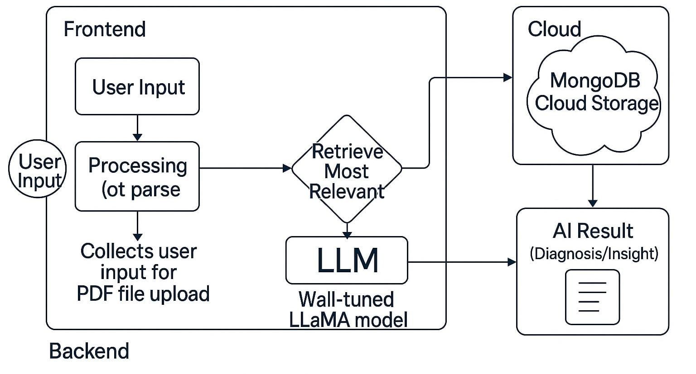

# Health Vision: RAG-Enabled LLM for Automated Medical Report Analysis & Actionable Health Insights

<div align="center">



[](https://nodejs.org/)
[](https://react.dev/)
[](https://expressjs.com/)
[](https://www.mongodb.com/)
[](https://ai.google.dev/)
[](https://www.docker.com/)
[](https://opensource.org/licenses/MIT)

**Health Vision** is a next-generation clinical diagnostics assistant powered by a Retrieval-Augmented Generation (RAG) Large Language Model (LLM) pipeline and a modern Spatial UI design system. It parses, standardizes, and interprets complex lab reports (Blood, Urine, Pap Smear, Stool, and Semen) against clinical taxonomy reference ranges, delivering actionable health insights, historical biomarker telemetry, and secure cloud archiving.

</div>

---

## ⚡ Quick Demo Sign-In Credentials

Health Vision is configured and seeded out-of-the-box for instant live demonstration. You can sign in immediately using:

| Field | Value |
|---|---|
| **Patient Name** | **Krishn Kushwaha** |
| **Email** | `demo@123` |
| **Password** | `password@24` |
| **Clinical Profile** | **Age: 20**, **Weight: 162 lbs.**, **Height: 5'10"**, **Sex: Male**, **Ethnicity: Asian** |
| **Preloaded Data** | Baseline & follow-up Complete Metabolic Panels (Hemoglobin, Fasting Glucose, Total Cholesterol, Vitamin D, Creatinine, WBC) & AI Chatbot session |

*Tip: On the Sign-In page (`http://localhost:3000/login`), you can also click the **"⚡ Auto-Fill"** button to load these credentials with one click.*

---

## 📑 Table of Contents

- [Key Highlights & New Capabilities](#-key-highlights--new-capabilities)
- [System Architecture & RAG Pipeline](#-system-architecture--rag-pipeline)
- [Updated Technology Stack](#-updated-technology-stack)
- [Project Directory Structure](#-project-directory-structure)
- [Environment Configuration](#-environment-configuration)
- [Getting Started](#-getting-started)
  - [Prerequisites](#prerequisites)
  - [Bare-Metal Local Setup](#bare-metal-local-setup)
  - [Docker & Containerized Setup](#docker--containerized-setup)
- [Client Routing & UI Surfaces](#-client-routing--ui-surfaces)
- [API Reference](#-api-reference)
- [Roadmap & Future Extensions](#-roadmap--future-extensions)
- [License & Acknowledgments](#-license--acknowledgments)

---

## ✨ Key Highlights & New Capabilities

- **Spatial UI Design System & Neomorphic Aesthetics**:
  - Implements a modern Spatial Canvas featuring frosted glass headers (`backdrop-filter: blur(20px)`), interactive emerald/mint gradients, floating navigation docks, and micro-elevation transitions.
  - Custom typography paired with **Plus Jakarta Sans** and **Outfit** for high-clarity clinical data readability.
- **Biomarker-Aware RAG Diagnostic Engine**:
  - Automatically correlates user queries and lab metrics with an indexed clinical biomarker knowledge base (`biomarkers.json`).
  - Powered by **Google Gemini 1.5 Pro** (`@google/generative-ai`) with dynamic system prompting and fallback architecture.
  - Supports private offline inferencing via **Ollama** (`medichat-llama3`).
- **Automated Medical Lab PDF Ingestion & Parsing**:
  - High-precision biomarker extraction using `pdf-parse` and algorithmic regex pattern matching.
  - Automatic unit normalization, scaling factor alignment, and status classification (**Normal**, **Low**, **High**).
- **Interactive Multi-Axis Telemetry & Visualization**:
  - Longitudinal trend charts built with **Recharts** (`ComposedChart`, `ResponsiveContainer`, `Area`, `Line`) and **Chart.js** (`react-chartjs-2`).
  - Dynamic circular SVG health score dials and status-coded risk indicators.
  - Integrated in-browser PDF report preview via `@simplepdf/react-embed-pdf` and `react-pdf`.
- **Enterprise-Grade Cloud & Security**:
  - Encrypted report vaulting on **AWS S3** with time-restricted presigned download URLs.
  - Stateless **JWT** authentication and **bcrypt** salted password hashing.
  - MongoDB session persistence (`connect-mongodb-session`) and **Joi** request validation.

---

## 🧠 System Architecture & RAG Pipeline

```
  +------------------------------------------------------------------------+
  |                     Client: Spatial React 18 SPA                       |
  |  - Spatial Glass Dock  - Recharts Telemetry  - Embedded PDF Viewer     |
  +-----------------------------------+------------------------------------+
                                      | HTTP / REST (Axios)
                                      v
  +------------------------------------------------------------------------+
  |                  Server: Node.js & Express REST API                    |
  |  - Routes: /api/auth, /api/users, /api/files, /api/conversations       |
  |  - JWT Authentication, Joi Validation, Multer In-Memory Storage        |
  +-----------------+-------------------+-------------------+--------------+
                    |                   |                   |
                    v                   v                   v
      +-----------------------+ +---------------+ +-----------------------+
      |  Clinical Extraction  | |    AWS S3     | |    Clinical RAG       |
      | - pdf-parse text stream| | Report Vault  | | - biomarkers.json     |
      | - Regex Normalization | | - Presigned   | | - Google Gemini 1.5   |
      | - Reference Range Map | |   Secure URLs | | - Ollama (Medichat)   |
      +-----------------------+ +---------------+ +-----------------------+
                                        |
                                        v
                          +---------------------------+
                          |      MongoDB Storage      |
                          | - Users, Reports, Biomarkers|
                          | - Persistent Chat History |
                          +---------------------------+
```

---

## 🚀 Updated Technology Stack

### Frontend (Client)
| Component / Library | Version | Purpose |
|---|---|---|
| **React** | `^18.3.1` | Core UI framework with Concurrent Mode support |
| **React Router DOM** | `^6.2.1` | Declarative client-side routing & protected route guards |
| **Spatial CSS System** | Custom Vanilla | Neomorphic spatial styling, interactive green palette, frosted glass docks |
| **Recharts** | `^2.14.1` | Multi-variable biomarker telemetry (`ComposedChart`, `Area`, `Line`) |
| **Chart.js & React-Chartjs-2**| `^4.4.7` / `^5.2.0` | Categorical bar graphs and distribution charts |
| **MUI & MUI X-Charts** | `^5.15.19` / `^7.23.1` | Material components and secondary charting utilities |
| **SimplePDF & React-PDF** | `^1.7.1` / `^8.0.2` | In-browser PDF report rendering and inspection |
| **React Icons & FontAwesome** | `^5.2.1` / `^6.7.1` | Modern clinical icon sets (Feather & FontAwesome Solid) |
| **Axios** | `^0.24.0` | Promise-based HTTP client for API interactions |
| **UUID** | `^9.0.1` | Unique conversation and session ID generation |

### Backend (Server)
| Component / Library | Version | Purpose |
|---|---|---|
| **Node.js** | `>=18.0.0` | Server runtime environment |
| **Express.js** | `^4.19.2` | RESTful API server and middleware pipeline |
| **MongoDB & Mongoose** | `^6.1.2` | ODM database modeling for users, reports, and messages |
| **connect-mongodb-session**| `^5.0.0` | MongoDB-backed session persistence for `express-session` |
| **Google Generative AI** | `^0.11.4` | Google Gemini 1.5 Pro client for medical RAG inference |
| **AWS SDK (S3)** | `^2.1692.0` | Encrypted cloud report storage and presigned download URLs |
| **pdf-parse & pdf2table** | `^1.1.1` / `^0.0.2` | High-speed PDF text and table extraction |
| **bcrypt** | `^5.1.1` | Cryptographic password hashing |
| **jsonwebtoken (JWT)** | `^8.5.1` | Stateless signed authentication tokens |
| **Joi** | `^17.5.0` | Strict schema validation for incoming API payloads |
| **Multer** | `^1.4.5-lts.1` | In-memory multipart/form-data upload handling |

---

## 🔧 Project Directory Structure

```text
elixer-ai/
├── Dockerfile                     # Multi-stage production container build
├── docker-compose.yml             # Orchestration for client, server, and MongoDB
├── Architecture.jpg               # System architecture reference diagram
├── Database image.png             # Data model diagram
├── README.md                      # Comprehensive project documentation
└── Elixer/
    ├── .env                       # Root environment variables
    ├── client/                    # React 18 Spatial Frontend
    │   ├── .env                   # Client API base URL configuration
    │   ├── package.json           # Client dependencies and build scripts
    │   ├── public/
    │   │   └── index.html         # HTML entry point with Google Fonts
    │   └── src/
    │       ├── App.js             # Route definitions and authentication gate
    │       ├── index.js           # React root renderer
    │       ├── index.css          # Spatial UI design tokens and global variables
    │       └── components/
    │           ├── Charts/        # Bar & distribution chart wrappers
    │           ├── Login/         # User login form
    │           ├── Signup/        # User registration form
    │           ├── Main/          # Dashboard, Profile, and RAG Chatbot
    │           │   ├── index.jsx  # Main Spatial Health Dashboard
    │           │   ├── chatbot.jsx# RAG Medical Assistant Chatbot
    │           │   ├── profile.jsx# Patient clinical demographics
    │           │   └── styles.module.css # Spatial glassmorphic component styles
    │           └── Reports/       # Diagnostic report modules
    │               ├── AddReports.jsx        # PDF upload & extraction trigger
    │               ├── BiomarkerCard.jsx     # Individual biomarker status cards
    │               ├── BiomarkerExpanded.jsx # In-depth trend & analytics modal
    │               ├── labreports.jsx        # Historical report archive
    │               ├── reports.jsx           # Diagnostic report overview
    │               └── results.jsx           # Aggregated clinical lab results
    └── server/                    # Express.js REST API Backend
        ├── index.js               # Express application entry & middleware
        ├── db.js                  # Mongoose database connection
        ├── package.json           # Backend dependencies and scripts
        ├── controllers/           # Business logic controllers
        │   ├── bloodReportController.js
        │   ├── conversationController.js
        │   └── fileRetrieval.js
        ├── models/                # Mongoose database schemas
        │   ├── bloodReport.js
        │   ├── conversation.js
        │   ├── file.js
        │   └── user.js
        ├── routes/                # Express API endpoints
        │   ├── auth.js            # User login & credential authentication
        │   ├── bloodReports.js    # Biomarker result retrieval
        │   ├── conversations.js   # Gemini RAG conversational AI endpoint
        │   ├── files.js           # PDF upload, extraction, and S3 sync
        │   └── users.js           # Registration and profile data
        └── data/
            └── biomarkers.json    # Clinical taxonomy, reference ranges, & aliases
```

---

## ⚙️ Environment Configuration

Ensure the appropriate `.env` files are configured prior to starting the services.

### 1. Server Environment (`Elixer/server/.env` or `Elixer/.env`)
```ini
# Application Environment
NODE_ENV=development
PORT=8080

# Database
MONGODB_URI=mongodb://127.0.0.1:27017/elixer
# For MongoDB Atlas:
# MONGODB_URI=mongodb+srv://<user>:<password>@cluster.mongodb.net/elixer?retryWrites=true&w=majority

# Authentication Security
JWTPRIVATEKEY=your_secure_jwt_secret_key_change_in_production
SALT=10

# AI & LLM Engine (Google Gemini)
GEMINI_API_KEY=your_gemini_api_key_here

# Cloud Storage (AWS S3) - Optional for local test mode
AWS_ACCESS_KEY_ID=your_aws_access_key
AWS_SECRET_ACCESS_KEY=your_aws_secret_key
AWS_REGION=us-east-1
```

### 2. Client Environment (`Elixer/client/.env`)
```ini
# Backend API Base URL
REACT_APP_API_BASE_URL=http://localhost:8080/api
```

---

## 🏁 Getting Started

### Prerequisites
- **Node.js**: v18.x or v20.x+ (Recommended: Latest LTS)
- **npm**: v9+ (packaged with Node.js)
- **MongoDB**: Local MongoDB instance (`mongod`) running on port `27017`, a free [MongoDB Atlas](https://www.mongodb.com/atlas) cluster, or Docker.

---

### Bare-Metal Local Setup

#### Step 1: Clone and Navigate
```bash
git clone https://github.com/Rbholika/elixer-ai-rag-llm-biomarker-medical-report-analysis-healthcare-diagnostics.git
cd elixer-ai-rag-llm-biomarker-medical-report-analysis-healthcare-diagnostics-main
```

#### Step 2: Install Backend Dependencies
```bash
cd Elixer/server
npm install
```

#### Step 3: Install Frontend Dependencies
```bash
cd ../client
npm install --legacy-peer-deps
```

#### Step 4: Run the Backend Server
```bash
cd ../server
npm start
# Server starts on http://localhost:8080
```

#### Step 5: Run the Frontend Client
In a separate terminal:
```bash
cd Elixer/client
npm start
# Client starts on http://localhost:3000
```

Visit **`http://localhost:3000`** in your browser.

---

### Docker & Containerized Setup

You can run the entire stack (Frontend, Backend, and MongoDB) using Docker Compose:

```bash
# Build and start all services in detached mode
docker-compose up --build -d

# Check service logs
docker-compose logs -f

# Stop all containers
docker-compose down
```

- **Frontend**: `http://localhost:3000`
- **Backend API**: `http://localhost:5000` (or configured port)
- **MongoDB**: `localhost:27017`

---

## 🧭 Client Routing & UI Surfaces

| Route Path | Description | Access |
|---|---|---|
| `/login` | User login portal | Public |
| `/signup` | Patient onboarding and clinical baseline profile | Public |
| `/` | **Main Spatial Dashboard**: Vital scores, quick actions, biomarker preview | Authenticated |
| `/chat` | **RAG Clinical Assistant**: AI conversation powered by Gemini 1.5 Pro | Authenticated |
| `/reports` | Diagnostics Hub: Report status, overview, and history | Authenticated |
| `/reports/add` | **Report Upload**: PDF dropzone, real-time extraction, biomarker review | Authenticated |
| `/reports/labreports` | Lab report archives with presigned S3 document access | Authenticated |
| `/reports/results` | Aggregated biomarker dashboard with status filtering | Authenticated |
| `/reports/biomarker/:name` | Longitudinal multi-axis telemetry for specific biomarkers | Authenticated |
| `/profile` | Patient demographic details (Age, Sex, Height, Weight, Ethnicity) | Authenticated |

---

## 📡 API Reference

### Authentication & Users
- `POST /api/users`: Register a new patient account with clinical demographics.
- `POST /api/auth`: Authenticate credentials and receive a JWT session token.
- `GET /api/users/profile/:token`: Retrieve patient clinical profile details.

### Medical Reports & Biomarkers
- `POST /api/files`: Upload a PDF report (Multer memory buffer), parse biomarkers, and sync to AWS S3.
- `GET /api/files/:token`: Retrieve patient report documents with secure S3 presigned URLs.
- `GET /api/bloodreport/:token`: Retrieve parsed biomarker records and status flags.

### RAG Clinical AI Assistant
- `POST /api/conversations`: Send patient query, retrieve relevant biomarker context, and generate a clinical response via Google Gemini 1.5 Pro or Ollama.
- `GET /api/conversations/:token`: Fetch historical chat sessions and conversation threads for the authenticated user.

---

## 🔮 Roadmap & Future Extensions

- [ ] **Multi-Modal Vision Diagnostics**: Expand RAG capabilities to interpret medical imaging modalities (Chest X-Ray, Brain MRI, ECG rhythm strips).
- [ ] **EHR / FHIR Compatibility**: Direct interoperability with hospital electronic health record systems (Epic, Cerner) using HL7 FHIR standards.
- [ ] **Wearable Health Sync**: Continuous telemetry ingestion from Apple HealthKit, Google Fit, and continuous glucose monitors (CGM).
- [ ] **Predictive Risk Modeling**: Longitudinal biomarker drift analysis for preventive cardiology and metabolic syndrome early warnings.

---

## 📜 License & Acknowledgments

This project is licensed under the **MIT License** - see the `LICENSE` file for details.

### Acknowledgments
- **Google Generative AI** team for Gemini 1.5 Pro inference capabilities.
- **Recharts** & **Chart.js** teams for exceptional data visualization libraries.
- **FontAwesome** & **Feather Icons** for clinical iconography.
- The open-source healthcare & diagnostics community for reference datasets and continuous inspiration.
